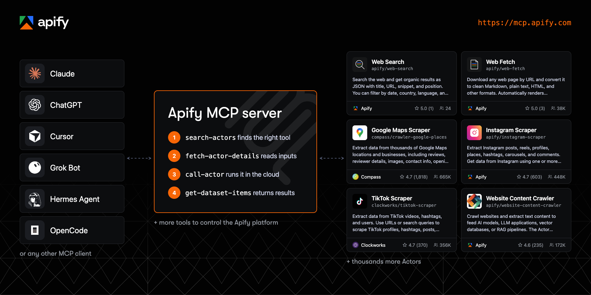
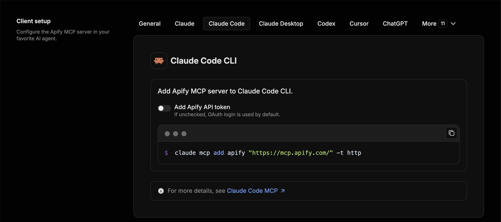

<p align="center">
    <a href="https://mcp.apify.com">
        
    </a>
</p>
<p align="center">
    <a href="https://mcp.apify.com"></a>
</p>
<p align="center">
    <a href="https://www.npmjs.com/package/@apify/actors-mcp-server"></a>
    <a href="https://www.npmjs.com/package/@apify/actors-mcp-server"></a>
    <a href="https://github.com/apify/apify-mcp-server/actions/workflows/on_master.yaml"></a>
    <a href="./LICENSE.md"></a>
</p>
<p align="center">
    <a href="https://github.com/apify/apify-mcp-server/stargazers"></a>
    <a href="https://discord.apify.com"></a>
</p>

# Apify MCP server

Connect your agent to the largest marketplace of tools for AI.

**The official Apify Model Context Protocol (MCP) server gives AI agents web scraping, data extraction, and browser automation through thousands of ready-made Actors from [Apify Store](https://apify.com/store), at [`https://mcp.apify.com`](https://mcp.apify.com).**

Apify is the marketplace of ready-to-run tools for AI agents. One connection to the Apify MCP server gives your agent thousands of tools to choose from, for jobs like web fetch, SERP monitoring, lead generation and enrichment, and pulling data from e-commerce sites and social media. The server loads only what each task needs.

Your agent searches Apify Store, checks an Actor's input and pricing, runs it, and reads the structured results, so you don't install a separate MCP server for every site. Connect to the hosted server with OAuth, or run it locally over stdio with the [`@apify/actors-mcp-server`](https://www.npmjs.com/package/@apify/actors-mcp-server) npm package.



<!-- TODO: add the new setup video here once it is published. The old 2025 Claude tutorial (BKu8H91uCTg) was removed as outdated. -->

## Contents

- [Quickstart](#-quickstart)
- [Set up your client](#-set-up-your-client)
- [Remote (hosted) or local MCP server](#remote-hosted-or-local-mcp-server)
- [How an agent uses Apify Actors](#how-an-agent-uses-apify-actors)
- [Tools, resources, and prompts](#%EF%B8%8F-tools-resources-and-prompts)
- [Choose which tools load](#choose-which-tools-load)
- [UI mode configuration](#ui-mode-configuration)
- [Example prompts](#-example-prompts)
- [Pricing and limits](#-pricing-and-limits)
- [Telemetry](#-telemetry)
- [Troubleshooting and limitations](#-troubleshooting-and-limitations)
- [FAQ](#-faq)
- [Development](#-development)
- [Contributing](#-contributing)
- [Privacy and license](#-privacy-and-license)
- [Learn more](#-learn-more)

## 🚀 Quickstart

1. Open the [MCP configurator](https://mcp.apify.com), pick your client, and choose the tools you want.
2. Copy the generated configuration, deeplink, or command into your client.
3. Sign in to Apify in the browser window that opens. If you don't have an account, you can create a free one there.

The hosted endpoint is `https://mcp.apify.com`. If your client can't use OAuth, send your [Apify API token](https://docs.apify.com/integrations/api#api-token) in an `Authorization: Bearer <APIFY_TOKEN>` header instead. Treat the token like a password and keep it out of repositories.

Using a coding agent such as Claude Code, Codex, Cursor, or GitHub Copilot? An [official Apify plugin](https://docs.apify.com/agents/plugins) installs this MCP server together with [Apify agent skills](https://docs.apify.com/agents/skills) in one step.

## 🤖 Set up your client

The [configurator](https://mcp.apify.com) generates the exact setup for each supported client, including Claude Code, ChatGPT, Cursor, VS Code, GitHub Copilot CLI, Claude, Claude Desktop, Codex, OpenCode, Kiro, and more. The snippets below cover the most common cases.



<details>
<summary><b>Claude Code</b></summary>

```bash
claude mcp add apify "https://mcp.apify.com" -t http
```

Claude Code opens the Apify sign-in page the first time it uses the server. To install the [Apify plugin](https://docs.apify.com/agents/plugins) with Apify agent skills instead, run `/plugin marketplace add apify/apify-claude-code-plugin`, then `/plugin install apify@apify` and `/reload-plugins`.

</details>

<details>
<summary><b>ChatGPT</b></summary>

1. Open [ChatGPT Plugins](https://chatgpt.com/plugins), select **+**, then **Add custom MCP server**.
2. Name it `Apify`, enter `https://mcp.apify.com` as the server URL, and choose **OAuth** authentication.
3. Review the risk warning, select **I understand and want to continue**, then **Create as a plugin**.
4. Sign in with Apify, review the tools, and install the plugin. No API token is needed.
5. Start a new conversation, type `@`, and select **Apify**.

In Business, Enterprise, and Edu workspaces, an admin or owner may need to create or publish the plugin. If the option is missing, ask your workspace admin. When the server's tools change, open the plugin and select **Refresh**.

The ChatGPT desktop app uses local MCP configuration shared with Codex instead: go to **Settings** > **MCP servers** > **Add server**, choose Streamable HTTP, and enter `https://mcp.apify.com`. See OpenAI's [custom MCP server guide](https://help.openai.com/en/articles/12584461-connecting-custom-mcp-servers-in-chatgpt).

</details>

<details>
<summary><b>Cursor</b></summary>

Use the one-click install link from the [configurator](https://mcp.apify.com), or let the [Apify CLI](https://docs.apify.com/cli) write the configuration, including your API token:

```bash
apify mcp install cursor
```

The same command works for `claude-code`, `vscode`, `codex`, `kiro`, and `antigravity`.

</details>

<details>
<summary><b>VS Code and GitHub Copilot</b></summary>

Use the one-click install link from the [configurator](https://mcp.apify.com), run `apify mcp install vscode`, or add `https://mcp.apify.com` as an HTTP server in your MCP configuration:

```json
{
  "servers": {
    "apify": {
      "type": "http",
      "url": "https://mcp.apify.com"
    }
  }
}
```

</details>

<details>
<summary><b>Claude</b></summary>

Apify is available as a Claude connector. Open **Settings** > **Connectors**, find **Apify** in the connector directory, and connect it. You can also select **Add custom connector**, name it `Apify`, and enter `https://mcp.apify.com` as the remote MCP server URL. Sign in with Apify when prompted. The same connector works on Claude.ai and in Claude Desktop. See the [Claude guide](https://docs.apify.com/integrations/claude-desktop).

</details>

<details>
<summary><b>Any other MCP client (JSON config)</b></summary>

Most clients that support remote servers and OAuth accept a configuration like this:

```json
{
  "mcpServers": {
    "apify": {
      "url": "https://mcp.apify.com"
    }
  }
}
```

</details>

<details>
<summary><b>Local stdio (npx)</b></summary>

Requires Node.js 22 or later.

```json
{
  "mcpServers": {
    "actors-mcp-server": {
      "command": "npx",
      "args": ["-y", "@apify/actors-mcp-server"],
      "env": {
        "APIFY_TOKEN": "YOUR_APIFY_TOKEN"
      }
    }
  }
}
```

If you've run `apify login`, the server can also read the token saved by the Apify CLI. Run `npx @apify/actors-mcp-server --help` for all options.

</details>

The server is also listed in the [Docker MCP catalog](https://hub.docker.com/mcp/server/apify-mcp-server/overview), and each [release](https://github.com/apify/apify-mcp-server/releases/latest) ships an MCP bundle file ([`apify-mcp-server.mcpb`](https://github.com/apify/apify-mcp-server/releases/latest/download/apify-mcp-server.mcpb)) for one-click installation in clients that support it.

## Remote (hosted) or local MCP server

The hosted remote MCP server with OAuth is the recommended option. Use the local server when you want to run the MCP process on your own machine; Actors still run and store their results on the Apify platform in both modes. If your client supports only stdio, you can also bridge it to the hosted server with [`mcp-remote`](https://www.npmjs.com/package/mcp-remote): `npx mcp-remote https://mcp.apify.com`.

| | Hosted (`https://mcp.apify.com`) | Local (`npx @apify/actors-mcp-server`) |
| :--- | :--- | :--- |
| Transport | Streamable HTTP | stdio |
| Authentication | OAuth or Bearer token | `APIFY_TOKEN` environment variable or Apify CLI login |
| Output schemas inferred for Actor results | Yes | No |
| Tool selection | `tools` URL parameter | `--tools` flag or `TOOLS` environment variable |
| Updates | Always the latest server | The npm version you install |

## How an agent uses Apify Actors

[Actors](https://docs.apify.com/actors) are serverless programs on the Apify platform. Each one does a specific job, like scraping Google Maps, crawling a website for RAG, or collecting social media posts. The MCP server turns Actors into tools an agent can find and call without you configuring each one in advance.

A typical task follows four steps:

1. `search-actors` finds candidate Actors in Apify Store for the task.
2. `fetch-actor-details` returns the Actor's input schema, README, and pricing, plus its output schema on request.
3. `call-actor` starts the run and waits for it to finish, 30 seconds by default and up to 45. It returns the **run status and storage IDs**; the scraped items stay in the run's dataset.
4. `get-dataset-items` reads the results from the run's dataset, with `limit` and `offset` for pagination.

The server adds `get-dataset-items`, `get-key-value-store-record`, `get-actor-run`, and `abort-actor-run` whenever `call-actor` or an Actor tool is loaded, so the agent can always read results and check on long runs that outlast the wait.

You can also expose a specific Actor as its own tool, for example `apify/web-search` or `apify/instagram-scraper`. The server builds the tool's parameters from the Actor's input schema, so the agent knows exactly what to pass.

**Actors that run their own MCP server.** Some Actors are MCP servers themselves. `fetch-actor-mcp-tool-list` lists their tools, and `call-actor-mcp-tool` calls one. When such an Actor is loaded as a tool source, its tools are exposed under names in the form `username--actor-name--tool-name`. Apify Store also lists MCP-related Actors from independent creators; those are separate products with their own READMEs and pricing.

## 🛠️ Tools, resources, and prompts

Any [Actor](https://apify.com/store) can be a tool, and agents discover new ones as they work. By default, the server loads the `actors` and `docs` categories, two Actor tools ([RAG Web Browser](https://apify.com/apify/rag-web-browser) and [Web Fetch](https://apify.com/apify/web-fetch)), and `report-problem`. Everything else is opt-in by category or by tool name.

### Helper tools

Besides Actor tools, the server provides helper tools for the Apify platform:

- **Actors:** search Apify Store, list the Actors in your account, view their details, call tools on Actors that run MCP servers, send requests to Server Actors, and delete your own Actors.
- **Documentation:** search the Apify and Crawlee docs and fetch pages as context.
- **Runs and storage:** list runs, inspect them, read their logs, and read datasets and key-value stores.
- **Tasks and schedules:** manage saved Actor tasks and their public landing pages, and schedules that run Actors and tasks automatically.
- **Builds and versions:** build Actors, read build logs, and create, read, change, copy, and delete versions from files.
- **Apify API:** search the API reference, inspect an operation, and send requests to read or change data.

### Available tools

Legend for the **Enabled by default** column:

- ✅ In the default tool set.
- ⚡ Added automatically when `call-actor`, an Actor tool, or `get-actor-run` is loaded, which is true in the default configuration.
- ✅¹ Served by default only when telemetry is on and the client name doesn't contain `claude`, `anthropic`, or `local-agent-mode`. Select it explicitly with `tools=report-problem` or `tools=dev` to serve it to any client; telemetry still has to be on.

| Tool name | Category | Description | Enabled by default |
| :--- | :--- | :--- | :---: |
| `search-actors` | actors | Search for Actors in Apify Store. | ✅ |
| `fetch-actor-details` | actors | Get an Actor's input schema, README (summary when available, full otherwise), pricing, and a Server Actor's HTTP operations. The output schema is opt-in. | ✅ |
| `call-actor` | actors | Run an Actor and return its run status and storage IDs. Use `fetch-actor-details` first to get the input schema. | ✅ |
| `fetch-actor-mcp-tool-list` | actors | List the tools of an Actor that runs an MCP server, with their schemas, annotations, and metadata. | ✅ |
| `call-actor-mcp-tool` | actors | Call one tool on an Actor's MCP server and return its result. | ✅ |
| `get-actor-run` | runs | Get details about an Actor run. | ⚡ |
| `get-dataset-items` | storage | Read items from a dataset, with filtering and pagination. | ⚡ |
| `get-key-value-store-record` | storage | Get the value stored under a key in a key-value store. | ⚡ |
| `abort-actor-run` | runs | Abort a running Actor run, optionally gracefully. | ⚡ |
| `search-apify-docs` | docs | Search the Apify and Crawlee documentation for relevant pages. | ✅ |
| `fetch-apify-docs` | docs | Fetch the full content of a documentation page by its URL. | ✅ |
| [`apify--rag-web-browser`](https://apify.com/apify/rag-web-browser) | Actor (see [Choose which tools load](#choose-which-tools-load)) | Search the web and return the content of the top results. | ✅ |
| [`apify--web-fetch`](https://apify.com/apify/web-fetch) | Actor (see [Choose which tools load](#choose-which-tools-load)) | Fetch a URL and return its content as Markdown, text, HTML, or other formats. | ✅ |
| `report-problem` | dev | Report a problem with an Apify tool or Actor to the Apify team. | ✅¹ |
| `get-actor-list` | none (select by name: `tools=get-actor-list`) | List the Actors you own and those shared with you, including private ones. | |
| `send-server-actor-request` | none (select by name: `tools=send-server-actor-request`) | Send one HTTP request to a Server Actor's API, as documented by its API schema, and return the response. | |
| `delete-actor` | none (select by name: `tools=delete-actor`) | Delete an Actor from your account permanently. Public Actors must be unpublished first. | |
| `get-actor-run-list` | runs | List Actor runs, filtered by Actor and status. | |
| `get-actor-run-log` | runs | Read the log of an Actor run. | |
| `get-dataset` | storage | Get metadata about a dataset. | |
| `get-dataset-schema` | storage | Generate a JSON schema from dataset items. | |
| `get-dataset-list` | storage | List the datasets in your account. | |
| `get-key-value-store` | storage | Get metadata about a key-value store. | |
| `get-key-value-store-keys` | storage | List the keys in a key-value store. | |
| `get-key-value-store-list` | storage | List the key-value stores in your account. | |
| `create-actor-task` | tasks | Create a saved Actor task (a named, reusable Actor configuration). | |
| `get-actor-task` | tasks | Get a saved Actor task, its publication state, and its public display configuration. | |
| `update-actor-task` | tasks | Update a task's input, run options, or public display configuration. | |
| `publish-actor-task` | tasks | Publish a task on its public landing page. | |
| `unpublish-actor-task` | tasks | Unpublish a task from its public landing page. | |
| `create-schedule` | schedules | Create a schedule that runs Actors or tasks on a cron expression. | |
| `get-schedule` | schedules | Get a schedule, its cron expression, state, and the actions it runs. | |
| `update-schedule` | schedules | Update a schedule's cron expression, time zone, enabled state, or actions. | |
| `delete-schedule` | schedules | Delete a schedule. | |
| `build-actor` | builds | Build an Actor version and wait a bounded time for the build to finish. | |
| `get-actor-build` | builds | Get the status of an Actor build. | |
| `get-actor-build-list` | builds | List the account's builds, or one Actor's, in every status, newest first. | |
| `get-actor-build-log` | builds | Read the log of an Actor build. | |
| `get-actor-version` | versions | Get an Actor version's file listing with hashes, plus the content of the files you ask for. | |
| `create-actor` | versions | Create a private Actor in your account from files, optionally starting a build. | |
| `update-actor-version` | versions | Write, edit, or delete files of an Actor version in one all-or-nothing write. | |
| `create-actor-version` | versions | Add a version to an Actor, from files or as a copy of another version, optionally starting a build. | |
| `delete-actor-version` | versions | Delete an Actor version. Its builds and their tags stay. | |
| `apify-api-search` | api | Search the Apify API reference by keywords. Returns each operation's method, path, and docs page. | |
| `apify-api-details` | api | Get the parameters and request body schema of the Apify API operations on a path. | |
| `apify-api-read` | api | Send a GET request to an Apify API path, like `apify api` in the Apify CLI. It refuses GETs to the synchronous run endpoints, which start a paid run. | |
| `apify-api-write` | api | Send a POST, PUT, PATCH, or DELETE request with a JSON body to any Apify API path, like `apify api` in the Apify CLI. | |

The `tasks` category manages saved [Actor tasks](https://docs.apify.com/actors/running/tasks). It is unrelated to the MCP Tasks protocol. The [tool reference](https://docs.apify.com/mcp#available-tools) has full descriptions of each tool.

### Tool annotations

Every tool carries a `title`, a `readOnlyHint`, and an `openWorldHint`. `readOnlyHint` is `true` for tools that only read data. Actor tools get it only for Apify-maintained Actors with limited permissions and no inputs that accept secrets, writable storage, an MCP connector, or code; other Actor tools are marked destructive. `openWorldHint` is `true` for tools that reach outside the Apify platform, such as `call-actor`, and `false` for platform-only tools.

### Prompts and resources

No prompts are registered yet, so `prompts/list` returns an empty list. `resources/read` accepts any Apify API GET URL (`https://api.apify.com/v2/...`) and returns the response body using the session's Apify token, inlined up to 256 KB. Your data isn't enumerated in `resources/list`; `resources/templates/list` lists the common shapes with their paging parameters.

## Choose which tools load

The `tools` parameter takes categories, tool names, and Actor names, separated by commas. When you set it, the defaults are dropped and only what you list is loaded, plus the ⚡ run and storage tools whenever the list includes `call-actor` or an Actor. The easiest way to build a selection is the [configurator](https://mcp.apify.com).

Hosted server:

```text
https://mcp.apify.com?tools=actors,docs,apify/web-search,apify/web-fetch
```

Local server:

```bash
npx @apify/actors-mcp-server --tools actors,docs,apify/web-search,apify/web-fetch
```

To give an agent a single Actor, list only that Actor. The agent gets its tool plus the four ⚡ tools it needs to read the results:

```text
https://mcp.apify.com?tools=apify/instagram-scraper
```

> **Pin your tools in production.** The default tool set can change between versions. Set `tools` explicitly if you need a stable interface.

<details>
<summary><b>Backward compatibility with older configurations</b></summary>

- The `actors` URL parameter and `--actors` flag still work. They're merged into `tools`, so `?actors=apify/web-fetch` equals `?tools=apify/web-fetch`.
- `enableAddingActors`, `enable-adding-actors`, and `enableActorAutoLoading` were removed and are ignored. Dynamic Actor calls come from `call-actor`, which the default `actors` category includes.
- The selectors `add-actor`, `experimental`, and `preview` are retired and load nothing. Use `call-actor` or the `actors` category.
- `get-actor-log` was renamed to `get-actor-run-log`, and the `source` category to `versions`. The old names load nothing.
- `call-actor` no longer calls tools on MCP server Actors: the `actorName:toolName` form is rejected. Use `call-actor-mcp-tool` with `actor`, `tool`, and `arguments`. A selection that names `call-actor` alone needs `call-actor-mcp-tool` added.
- `fetch-actor-details` no longer lists an MCP server Actor's tools, and `output.mcpTools` is ignored. Use `fetch-actor-mcp-tool-list`, which returns the definitions in `structuredContent.tools`. A selection that names `fetch-actor-details` alone needs `fetch-actor-mcp-tool-list` added.

</details>

## UI mode configuration

The `ui` parameter controls [MCP Apps](https://github.com/modelcontextprotocol/ext-apps) widget tools. With UI mode on, the server adds `search-actors-widget` and `fetch-actor-details-widget` next to their base tools, which keep returning standard responses. By default (`auto`), UI mode turns on when the client supports MCP Apps.

| Value | Behavior |
| :--- | :--- |
| `auto` (default) | Widget tools added when the client supports MCP Apps |
| `true`, `on`, or `apps` | Widget tools always added |
| `false`, `off`, or `default` | No widget tools |

Hosted server:

```text
https://mcp.apify.com?tools=actors,docs&ui=true
```

Local server, with a CLI flag or the `UI_MODE` environment variable:

```bash
npx @apify/actors-mcp-server --ui true
UI_MODE=true npx @apify/actors-mcp-server
```

## 💬 Example prompts

Ask in plain language. The agent finds a suitable Actor, checks its input and pricing, runs it, and reads the results. These prompts cover the most common jobs:

| Use case | Example prompt | Example Actor |
| :--- | :--- | :--- |
| Web research | "Find what people on X said about autonomous AI agents this week and summarize the key developments." | [Tweet Scraper V2](https://apify.com/apidojo/tweet-scraper) |
| Search and read the web | "Compare the current pricing plans of Notion, Coda, and Airtable and tell me which is cheapest for a 10-person team." | [Web Search](https://apify.com/apify/web-search), [Web Fetch](https://apify.com/apify/web-fetch) |
| Search results (SERP) | "Get the top 20 Google results for 'best CRM for startups' in the US and show who ranks where." | [Google Search Results Scraper](https://apify.com/apify/google-search-scraper) |
| Lead generation | "Find dentists in Austin, Texas on Google Maps with their phone numbers, websites, and ratings." | [Google Maps Scraper](https://apify.com/compass/crawler-google-places) |
| LinkedIn profiles | "Get the current job title, company, and work history for these 20 LinkedIn profiles." | [LinkedIn Profile Scraper](https://apify.com/harvestapi/linkedin-profile-scraper) |
| LinkedIn company posts | "Get the 30 latest posts from Apify's LinkedIn company page with their reaction counts." | [LinkedIn Company Posts Scraper](https://apify.com/harvestapi/linkedin-company-posts) |
| Review analysis | "Pull the latest 100 Google Maps reviews for this hotel and group the complaints by theme." | [Google Maps Reviews Scraper](https://apify.com/compass/Google-Maps-Reviews-Scraper) |
| Social media monitoring | "Get the 50 latest posts from @nasa on Instagram with likes and comments." | [Instagram Scraper](https://apify.com/apify/instagram-scraper) |
| Trend research | "Find the most viewed TikTok videos for #skincare this week." | [TikTok Scraper](https://apify.com/clockworks/tiktok-scraper) |
| E-commerce | "List the 10 best-rated wireless earbuds on Amazon with prices and review counts." | [Amazon Product Scraper](https://apify.com/junglee/amazon-crawler) |
| Knowledge base and RAG | "Crawl docs.example.com and turn every page into Markdown I can load into my vector database." | [Website Content Crawler](https://apify.com/apify/website-content-crawler) |

Follow-ups work too. "Show me the next 10 results from that run" makes the agent call `get-dataset-items` again with a higher `offset`. With the `schedules` category loaded, "Run that Google Maps search every Monday at 9 am" creates a schedule.

## 💰 Pricing and limits

- Connecting to the MCP server is free. Actor runs bill to your Apify account according to each Actor's pricing, which `fetch-actor-details` shows before a run. The [Apify free plan](https://apify.com/pricing) includes $5 of monthly platform usage.
- To cap what a run can cost, pass `maxTotalChargeUsd` (pay-per-event Actors) or `maxItems` (pay-per-result Actors) in the `callOptions` of `call-actor`. `timeout` and `memory` limit the run's duration and memory, not its price.
- The hosted server accepts up to 20 requests per second per account.
- `search-actors` returns only free and pay-per-event Actors that pass the platform's agent-safety filters, so rental and pay-per-result Actors don't appear in search. [Full-permission Actors](https://docs.apify.com/actors/running/permissions#full-permission-actors) need your one-time approval; until then, `call-actor` returns an error with an approval link.
- Some tools work without an Apify account: `search-actors`, `fetch-actor-details`, `search-apify-docs`, `fetch-apify-docs`, `apify-api-search`, and `apify-api-details`. Select only those, for example `https://mcp.apify.com?tools=search-actors`, and the hosted server accepts the connection without a token.

> 🪙 **Agentic payments (experimental).** Agents can pay for Actor runs without an Apify account. [AGI](https://agi.apify.com) sells a prepaid, spend-capped Apify API token for an x402, MPP, or Skyfire payment. The agent then uses it as a normal Bearer token against `mcp.apify.com`, with any Actor. See the [agentic payments documentation](https://docs.apify.com/agents/payments) for supported methods and limits, and [agi.apify.com/AGENTS.md](https://agi.apify.com/AGENTS.md) for protocol details.

## 📡 Telemetry

The Apify MCP server collects telemetry about tool calls to help Apify understand usage patterns and improve the service. Telemetry is **on** by default. With telemetry on, Actor searches in Apify Store send the MCP session ID as `_traceId`, and tool-call events carry it as `trace_id`. `search-actors` also sends `_useCase`, a one-sentence reason for the search written by the model, which Apify uses to improve Store search results. The stdio transport also uses [Sentry](https://sentry.io) for error tracking, which helps the Apify team find and fix issues faster.

To opt out, including Sentry, set the `telemetry-enabled` URL parameter or the `--telemetry-enabled` CLI flag to `false`, or set `TELEMETRY_ENABLED=false`. CLI flags take precedence over environment variables.

```text
https://mcp.apify.com?telemetry-enabled=false
```

```bash
npx @apify/actors-mcp-server --telemetry-enabled=false
TELEMETRY_ENABLED=false npx @apify/actors-mcp-server
```

## 🐛 Troubleshooting and limitations

- **The local server won't start.** Check your Node.js version: the package requires Node.js 22 or later.
- **Authentication fails.** Reconnect so the client repeats the OAuth flow, or switch to a Bearer token. For the local server, check that `APIFY_TOKEN` is set in the client's server configuration, not only in your shell.
- **Client features vary.** Any MCP client can connect, but support for dynamic tool lists, OAuth, and MCP Apps differs between clients.
- **Invalid Actor input.** When `call-actor` fails because of invalid input, the error includes the Actor's input schema so the agent can correct the input and retry.

<details>
<summary><b>How the server adapts Actor input schemas</b></summary>

The server adapts Actor input schemas so that more clients and models can use them:

- Descriptions longer than 500 characters are cut at the last complete sentence and marked `[Description truncated]`.
- Enums are kept in full up to 2,000 combined characters. Larger enums are replaced by a short note with example values.
- Required fields get a `REQUIRED` prefix in their descriptions for frameworks that ignore the JSON Schema `required` list.
- Nested properties are built for special inputs such as proxy configuration and request lists.
- Missing array item types are inferred from the item type, the prefill, the default value, or the editor type, in that order.
- Prefill and default values are copied into descriptions as examples, for clients that ignore JSON Schema `examples`.

</details>

For more help, see the [MCP documentation](https://docs.apify.com/mcp) or [open an issue](https://github.com/apify/apify-mcp-server/issues).

## ❓ FAQ

**What is an MCP server?**
An MCP server exposes tools and data to AI agents through the [Model Context Protocol](https://modelcontextprotocol.io), an open standard supported by clients such as Claude, ChatGPT, and Cursor. The agent connects once and calls the server's tools when a task needs them. The Apify MCP server's tools are the Actors in Apify Store.

**What is the Apify MCP server?**
It's the official [Model Context Protocol](https://modelcontextprotocol.io) server for Apify. It lets AI agents search Apify Store, run Actors for web scraping, data extraction, and browser automation, and read the structured results.

**When is it a good MCP server for web scraping?**
When an agent needs data from many different sites. A typical case is Google Maps one day, Instagram or an online store the next. The agent picks a ready-made Actor for each site from Apify Store instead of you writing and maintaining a scraper. Each Actor works like a web scraping API for its site, and the Apify platform handles scaling, proxies, and storage of the results.

**How does it compare to Playwright MCP?**
Playwright MCP drives a browser on your machine step by step, through clicks and page snapshots. The Apify MCP server runs Actors in the Apify cloud. Each Actor handles JavaScript rendering, proxies, and blocking for its site and returns structured results, so the agent asks for the data instead of operating a browser. Many agents use both.

**Can ChatGPT or Claude scrape websites with it?**
Yes. Connect ChatGPT, Claude, or Claude Code to `https://mcp.apify.com`, then ask in plain language. The model searches for a suitable Actor, runs it, and reads the results.

**Is it free?**
Connecting is free, and some discovery tools work without an account. Actor runs bill to your Apify account at each Actor's price, and the free plan includes $5 of monthly platform usage.

**Do I need an API token?**
Not with the hosted server, because OAuth signs you in through the browser. The local server needs `APIFY_TOKEN` or an Apify CLI login.

**Can I limit what the agent can do or spend?**
Yes. Select tools with the `tools` parameter or expose a single Actor. To cap a run's cost, pass `maxTotalChargeUsd` for pay-per-event Actors or `maxItems` for pay-per-result Actors in `call-actor` options.

## 🔧 Development

This repository contains the open-source server package published to npm as [`@apify/actors-mcp-server`](https://www.npmjs.com/package/@apify/actors-mcp-server). The hosted service at mcp.apify.com runs on this core logic from a separate private repository.

You need Node.js 22 or later and pnpm.

```bash
pnpm install
pnpm run build
pnpm run dev              # Streamable HTTP server on http://localhost:3001, hot reload for widgets
pnpm run inspector:stdio  # MCP Inspector against the stdio server
```

The development HTTP server doesn't read `APIFY_TOKEN` from the environment. Pass your token in an `Authorization: Bearer` header or a `?token=` query parameter, for example from the [MCP Inspector](https://github.com/modelcontextprotocol/inspector).

To publish a canary build of a pull request to [pkg.pr.new](https://pkg.pr.new/), add the `beta` label to it.

[DEVELOPMENT.md](./DEVELOPMENT.md) covers the project structure, tool loading phases, the Node.js version policy, and testing.

## 🤝 Contributing

Bug reports, feature requests, and documentation fixes are welcome. [Open an issue](https://github.com/apify/apify-mcp-server/issues) with steps to reproduce a bug, or describe the problem a feature would solve and who runs into it. Send typos, broken links, and wrong commands straight to a pull request. For code, work only on an issue a maintainer has invited you to pick up; unsolicited pull requests are closed.

Read [CONTRIBUTING.md](./CONTRIBUTING.md) before you start, including the rules for [AI-assisted contributions](./CONTRIBUTING.md#ai-assisted-contributions).

## 🔒 Privacy and license

Requests and Actor inputs go to the Apify API to run the Actors you call. Apify doesn't share them with third parties beyond what running those Actors requires. See [Apify legal documents](https://docs.apify.com/legal) for details on data collection and retention.

The project is licensed under the [MIT license](./LICENSE.md).

## 📚 Learn more

- [MCP documentation](https://docs.apify.com/mcp): authentication, tool reference, and advanced configuration
- [Apify for AI agents](https://docs.apify.com/agents): choosing between MCP, plugins, agent skills, the CLI, and machine-readable docs
- [Apify agent skills](https://docs.apify.com/agents/skills): guided multi-step workflows, installed with `npx skills add apify/agent-skills`
- [Apify CLI](https://docs.apify.com/cli): running and building Actors from a terminal
- [Model Context Protocol](https://modelcontextprotocol.io)
- [MCP for beginners](https://blog.apify.com/mcp-for-beginners/)
- [How to use MCP with Apify Actors](https://blog.apify.com/how-to-use-mcp/)
- [Webinar: Building and monetizing MCP servers on Apify](https://www.youtube.com/watch?v=w3AH3jIrXXo)
